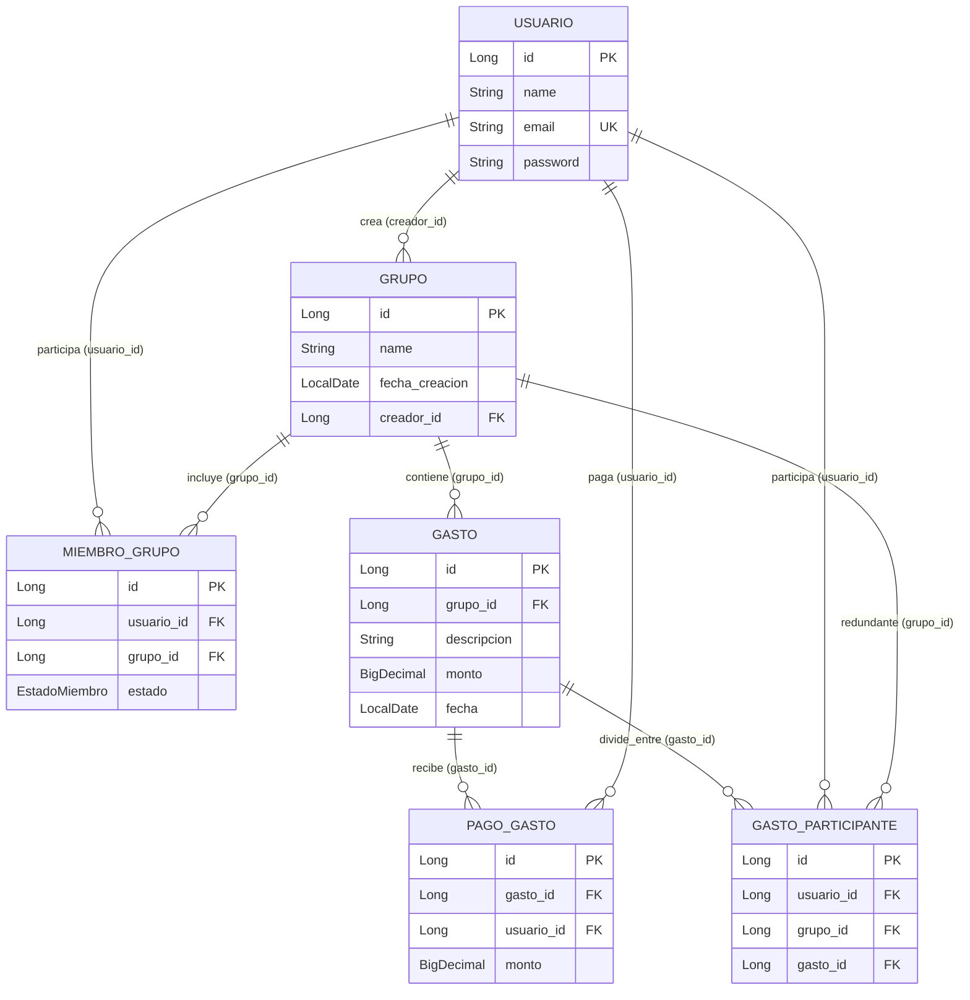

# F0.2.A — AUDITORÍA DEL MODELO DE DATOS Y PERSISTENCIA

**Proyecto:** Partly (`gestor-gastos`)  
**Fase:** F0.2.A (Auditoría de solo lectura — Desarrollador A)  
**Fecha:** 2026-11-24

> [!IMPORTANT]
> **Distinción de fuentes:** Todo el modelo descrito a continuación corresponde al **esquema lógico inferido desde las entidades JPA** (`src/main/java/com/gestorgastos/gestor_gastos/entity/`). **No se ha comprobado el esquema físico en una instancia MySQL en ejecución**, dado el alcance estrictamente de solo lectura y la prohibición de conectarse a bases de datos reales.

---

## 1. Modelo Entidad-Relación lógico (inferido del código real)

---

## 2. Análisis detallado por entidad

| Entidad / Archivo | PK | FKs | Unicidad | Nulabilidad explícita | Tipos monetarios | Cascadas / Eliminación |
|---|---|---|---|---|---|---|
| `Usuario` (`Usuario.java`) | `id` (`IDENTITY`) | Ninguna | `email` (`@Column(unique = true)`) | Ninguna (`name`, `email`, `password` permiten `NULL` en BD) | N/A | Sin cascadas |
| `Grupo` (`Grupo.java`) | `id` (`IDENTITY`) | `creador` (`@ManyToOne`) | Ninguna | Ninguna (`name`, `fecha_creacion`, `creador_id` permiten `NULL`) | N/A | Sin cascadas |
| `MiembroGrupo` (`MiembroGrupo.java`) | `id` (`IDENTITY`) | `usuario` (`@ManyToOne`), `grupo` (`@ManyToOne`) | **Falta `UNIQUE(usuario_id, grupo_id)`** | Ninguna (`estado` Enum `STRING`, permite `NULL`) | N/A | Sin cascadas |
| `Gasto` (`Gasto.java`) | `id` (`IDENTITY`) | `grupo` (`@ManyToOne`) | Ninguna | Ninguna (`descripcion`, `monto`, `fecha`, `grupo_id` permiten `NULL`) | `BigDecimal monto` sin `precision`/`scale` | Sin cascadas |
| `PagoGasto` (`PagoGasto.java`) | `id` (`IDENTITY`) | `gasto` (`@ManyToOne`), `usuario` (`@ManyToOne`) | Ninguna | Ninguna (`gasto_id`, `usuario_id`, `monto` permiten `NULL`) | `BigDecimal monto` sin `precision`/`scale` | Sin cascadas |
| `GastoParticipante` (`GastoParticipante.java`) | `id` (`IDENTITY`) | `usuario`, `grupo` (redundante), `gasto` | **Falta `UNIQUE(gasto_id, usuario_id)`** | Ninguna | N/A | Sin cascadas |

---

## 3. Hallazgos de persistencia e integridad

1. **Ausencia de migraciones versionadas:** No existe Flyway ni Liquibase. Se depende de `spring.jpa.hibernate.ddl-auto=update` (`application.properties:5`), lo cual es inseguro para producción (no gestiona renombrados, borrados de columnas, ni rollbacks, y puede alterar esquemas inadvertidamente).
2. **Falta de restricciones `NOT NULL` y `CHECK`:** Ninguna columna obligatoria ni clave foránea tiene `nullable = false` o `@JoinColumn(nullable = false)`. Tampoco hay restricciones `CHECK (monto > 0)` en BD.
3. **Falta de restricciones de unicidad compuestas:**
   - `MiembroGrupo` puede almacenar múltiples filas para el mismo `(usuario_id, grupo_id)` bajo concurrencia, rompiendo `miembroGrupoRepository.findByUsuarioIdAndGrupoId(...)` (que retorna `Optional<MiembroGrupo>` y lanzaría `IncorrectResultSizeDataAccessException`).
   - `GastoParticipante` puede almacenar participantes duplicados por gasto si se inserta fuera de `GastoController`.
4. **Precisión monetaria implícita:** `BigDecimal monto` en `Gasto` y `PagoGasto` carece de `@Column(precision = 19, scale = 2)` (o la precisión definida por el negocio), delegando el tipo `DECIMAL` al comportamiento por defecto del dialecto de Hibernate/MySQL.
5. **Relación redundante en `GastoParticipante`:** Almacena `grupo_id` además de `gasto_id` (cuando `Gasto` ya pertenece a un `Grupo`), generando riesgo de inconsistencia si un participante apuntara a un grupo distinto al del gasto.
6. **Ausencia de estrategia de eliminación y auditoría:**
   - No hay `created_at`, `updated_at`, `created_by`, `deleted_at` (soft-delete) ni `@Version` (bloqueo optimista).
   - Sin cascadas ni soft-delete, intentar eliminar un `Gasto`, `Grupo` o `Usuario` en el futuro fallará por restricciones de clave foránea en MySQL o requerirá borrados manuales en cascada con riesgo de pérdida de trazabilidad financiera.
7. **Comparación con `docs/DER.md`:** `docs/DER.md` refleja con exactitud las 6 entidades actuales y los 3 estados de `EstadoMiembro` (`PENDIENTE`, `MIEMBRO`, `RECHAZO`), pero no documenta restricciones de nulabilidad, índices ni precisión monetaria.
