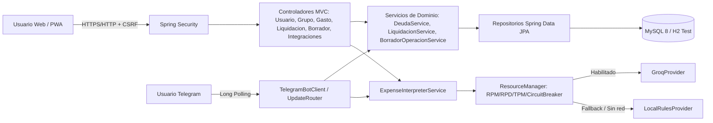
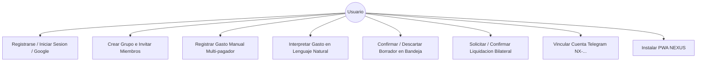
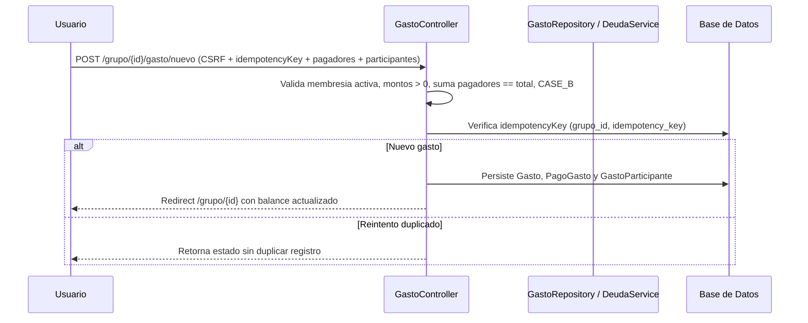
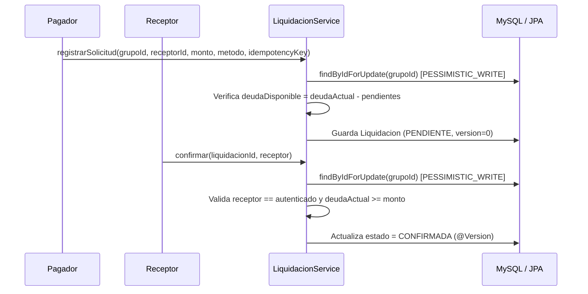
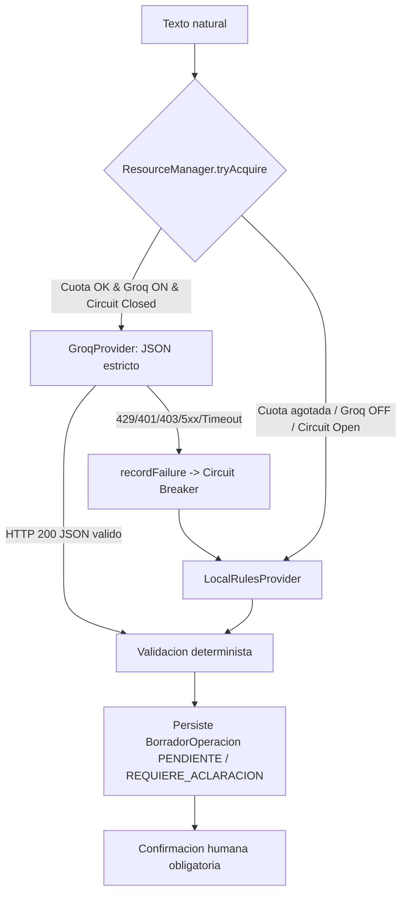
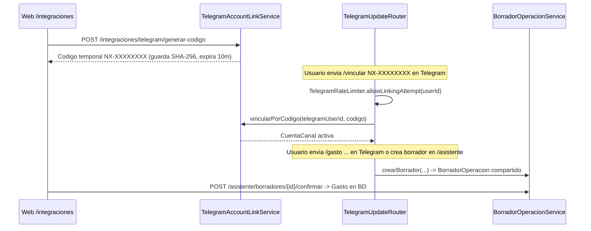

# Arquitectura Final — NEXUS

**Versión:** `v1.0-rc1` (Bloque B6)

---

## 1. Arquitectura General

## 2. Casos de Uso Principales

## 3. Flujo de Registro de Gasto Manual

## 4. Flujo de Liquidación Bilateral

## 5. Flujo de Interpretación Inteligente y `ResourceManager`

## 6. Vinculación Telegram y Sincronización entre Canales

