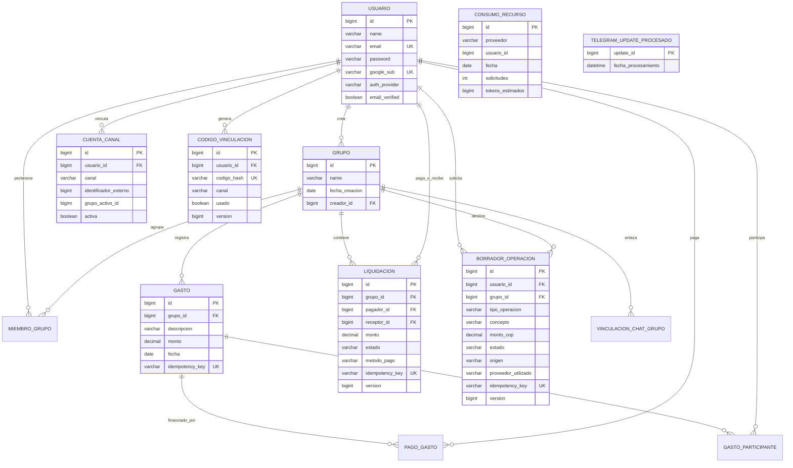

# Modelo de Datos Final — NEXUS

**Versión:** `v1.0-rc1` (Migraciones Flyway `V1`–`V4`)

---

## 1. Diagrama Entidad-Relación (Basado en `V1`–`V4`)

## 2. Resumen de Migraciones Flyway

| Versión | Archivo | Contenido principal |
|---|---|---|
| `V1` | `V1__baseline_schema.sql` | `usuario`, `grupo`, `miembro_grupo`, `gasto`, `pago_gasto`, `gasto_participante` |
| `V2` | `V2__liquidaciones.sql` | `liquidacion` con `DECIMAL(19,2)`, `idempotency_key`, `version` e índices |
| `V3` | `V3__borradores_y_recursos.sql` | `consumo_recurso` y `borrador_operacion` con `version` e idempotencia |
| `V4` | `V4__telegram_conectividad.sql` | `cuenta_canal`, `codigo_vinculacion`, `vinculacion_chat_grupo`, `telegram_update_procesado` |
